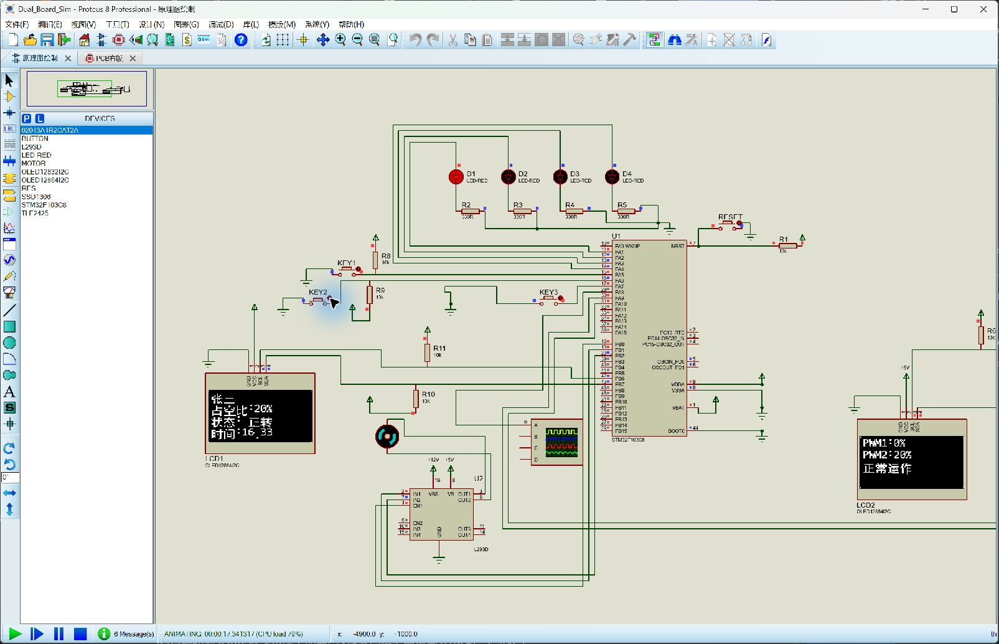

# STM32F103 双机控制与 Proteus 仿真

[](https://github.com/yum82409-cmyk/STM32-/actions/workflows/privacy-and-integrity.yml)

2026-10-25 更新：以最新本地验收版本替换旧工程，修复流水灯限流、计时时基、PWM1 时序、OLED 总线争用和复位后的暂停状态同步。公开版使用中文别名张三，字库和两机固件均已重新生成。

两片 STM32F103C8T6 实现 OLED 中文显示、四路流水灯、两路 PWM、电机调速与换向、USART 双向通信和远程暂停恢复。

## 快速运行

1. 下载仓库 ZIP 并完整解压，保留所有目录的相对位置。
2. 用 Proteus 8 打开 [Dual_Board_Sim.pdsprj](Proteus/Dual_Board_Sim.pdsprj)，启动仿真。
3. KEY1 触发 PWM1 的 4s 上升、2s 下降；KEY2 调整电机档位；KEY3 换向；B 机 PAUSE 暂停和恢复。
4. 查看波形时，在运行状态打开调试菜单中的 Digital Oscilloscope。

Proteus 实际加载 `fw/A/A.hex`、`fw/B/B.hex`，根目录另有相同副本。正式配置 `ACCEPTANCE_DEMO=0`、`DEBUG_DISPLAY=0`。



## 文件入口

- [操作与编译](docs/运行与编译.md)
- [电路引脚、时基和通信协议](docs/实现说明_2026-10-25.md)
- [验收记录与范围](docs/最终仿真验收报告_2026-10-25.md)
- [最终检查清单](FINAL_CHECKLIST.md)
- [赛题 PDF](赛题要求/2025年第7届电赛校赛初赛题目.pdf) · [赛题 PPT](赛题要求/赛题要求.pptx)
- [A 机源码](Firmware/A/) · [B 机源码](Firmware/B/)
- [最新发布包](https://github.com/yum82409-cmyk/STM32-/releases/latest)

## 编译和校验

需要 Windows、Python 3 和 Keil µVision；重新生成字库还需 Pillow 与 Windows 字体。

```text
python tools/build.py --keil "你的安装目录/UV4/UV4.exe"
python tools/verify_package.py
```

编译脚本在英文临时目录构建，避免旧版 Keil 读取中文路径失败；两机都零错误、零警告后才更新发布固件。修改代码并编译后，原有 `SHA256SUMS.txt` 会失效，发布前需重新生成校验清单。

本地参赛版本按题目功能复验建议模拟评分 100/100。公开版本沿用该控制逻辑和电路，仅替换姓名字库与显示调用；本次另行完成编译、工程加载和运行检查。详细测点与限制见验收记录，未进行实物验证。

## 隐私和历史

公开版姓名字段统一显示张三，原始实名截图不上传。已移除旧版重复的单片机目录与过期交付记录，旧版本仍可通过 Git 历史和旧发布标签查阅。
